# When AI Fails, What's Next? A Data-Driven Taxonomy of Real-World AI Incident Responses

This repository accompanies our research paper **"When AI Fails, What's Next? A Data-Driven Taxonomy of Real-World AI Incident Responses"**.

The paper analyzes real-world AI incident reporting to describe how organizations and other stakeholders respond when AI systems fail. Building upon the [MIT AI Risk Mitigation Taxonomy (RMT)](https://airisk.mit.edu/blog/mapping-ai-risk-mitigations), we propose the **AI Risk Response Taxonomy (RRT)**. The RRT is descriptive: it records which responses are reported after AI incidents, not whether those responses reduced harm, prevented recurrence or improved recovery.

As the manuscript is currently under consideration for publication, this repository represents an ongoing body of work and may not yet contain the final results. Additional materials and updates will be made available upon publication of the manuscript.

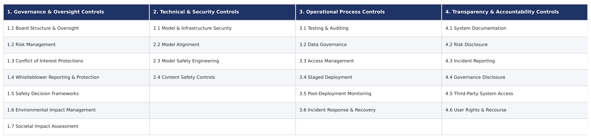

---

## Introduction

This research uses news media reports of AI incidents to study how organizations, courts, regulators and markets respond after AI systems fail. Each reported response action is mapped to a category of the RRT, giving a common vocabulary for comparing responses across incidents.

---

## Datasets

We use data from three repositories: the [AI Incident Database (AIID)](https://incidentdatabase.ai/), [AIAAIC](https://docs.google.com/spreadsheets/d/1Bn55B4xz21-_Rgdr8BBb2lt0n_4rzLGxFADMlVW0PYI/edit?gid=888071280#gid=888071280) and the [OECD AI Incidents Monitor (AIM)](https://oecd.ai/en/incidents), with **9,705** incident entries in total (AIID: 1,200; AIAAIC: 1,478; OECD AIM: 7,027).

Each entry is one incident in one repository, represented by a single news article (the first linked report or source). Further articles about the same incident within a repository are not included. Cross-repository duplicates were not removed, so all results are reported separately for each repository.

---

## Mitigation Extraction

Each incident text is submitted as an individual task to the OpenAI Batch API, where GPT-5-mini extracts the reported response actions. For 2,803 records the model returned "No mitigation taken"; actions were extracted from the remaining **6,902** records.

---

## Taxonomy

The extracted actions were submitted to GPT-5-mini to derive draft taxonomies. We manually reviewed each category and subcategory against the RMT, grouped unmatched subcategories, and defined **four new categories** and **two new subcategories** within existing categories. The RRT has **32 subcategories in 8 categories** (the RMT has 23).

New categories:
- **5. Corrective & Restrictive Actions**
- **6. Legal, Regulatory & Enforcement Actions**
- **7. Financial, Economic & Market Controls**
- **8. Avoidance & Denial**

New subcategories in existing categories: **3.7 Incident Investigation** and **4.7 Training & Supportive Measures**.

Some added subcategories partly overlap with RMT subcategories; the paper includes a crosswalk of all nine added subcategories against their closest RMT counterparts.

_The newly added subcategories and categories are in orange._
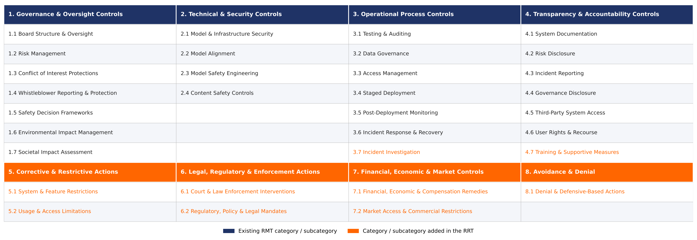

### Dual-track model and control-structure mapping

Not all responses are mitigation. The RRT separates:
- **Track A – Constructive Risk Controls** (Categories 1–7): responses that constrain, correct or compensate for the AI system's behaviour, including constraints imposed by courts, regulators and markets.
- **Track B – Institutional Posturing and Contestation** (Category 8): denial and defensive responses, which in STAMP terms act as friction on the feedback path and can delay corrective action.

**RRT categories mapped onto a STAMP hierarchical control structure**
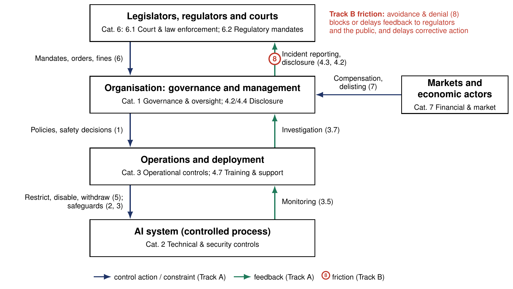

---

## Classification

Each record's complete list of extracted actions is classified as one unit with GPT-5-mini, which assigns up to five of the 32 subcategories. Nine AIID records were not saved because of an inconsistent model output format, leaving **6,893** classified records.

### Validation

Two annotators independently and blindly labelled **300 records**, without seeing the LLM's labels or each other's. The records were drawn by stratified random sampling so that each subcategory appeared 10–50 times; for subcategories that appeared fewer than 10 times, all records carrying them were included.

| Comparison | Pooled Jaccard | Mean Jaccard | Identical label sets | Pooled Cohen's κ |
|---|---|---|---|---|
| Annotator 1 vs Annotator 2 | 0.65 | 0.68 | 76 (25.3%) | 0.75 |
| LLM vs Annotator 1 | 0.75 | 0.77 | 138 (46.0%) | 0.83 |
| LLM vs Annotator 2 | 0.80 | 0.83 | 159 (53.0%) | 0.87 |

The LLM's labels agree with each annotator at least as closely as the annotators agree with each other.

---

## Results

The 6,893 classified records received **23,994** labels. Results are reported per repository:

| Dataset | Labels | In existing RMT subcategories | In added RRT subcategories |
|---|---|---|---|
| AIID | 4,218 | 2,662 (63.1%) | 1,556 (36.9%) |
| AIAAIC | 4,500 | 2,830 (62.9%) | 1,670 (37.1%) |
| OECD AIM | 15,276 | 8,873 (58.1%) | 6,403 (41.9%) |

These shares describe how often the added subcategories are used; they do not measure an expansion of the taxonomy itself, which grows from 23 to 32 subcategories.

**Labels in existing RMT subcategories and in subcategories added in the RRT, per dataset**
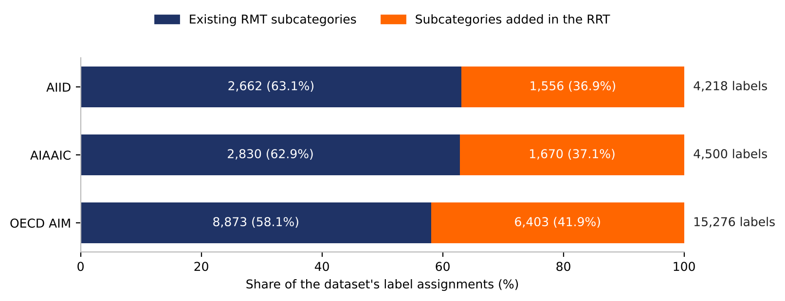

### AIID

**Number of labels per subcategory**
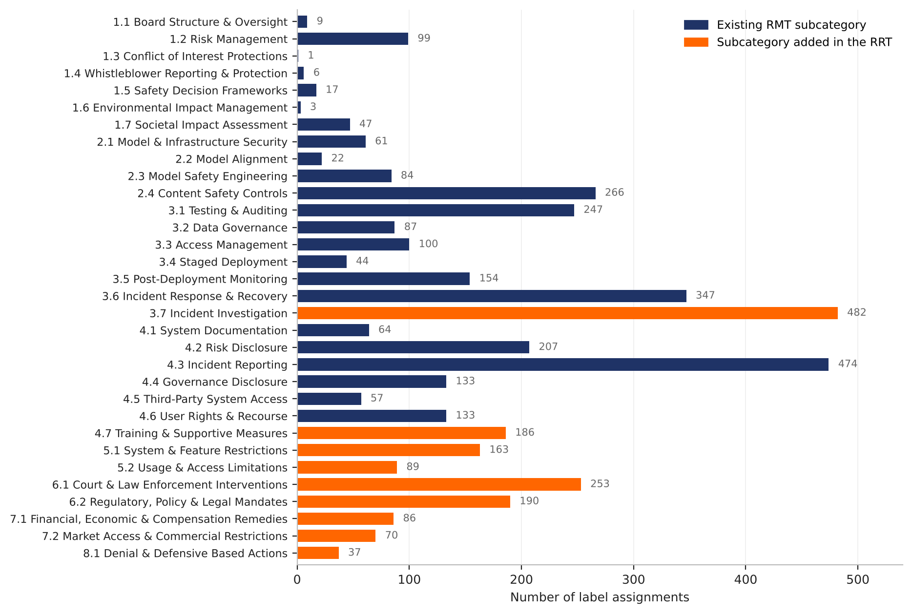

**Share of labels by category**
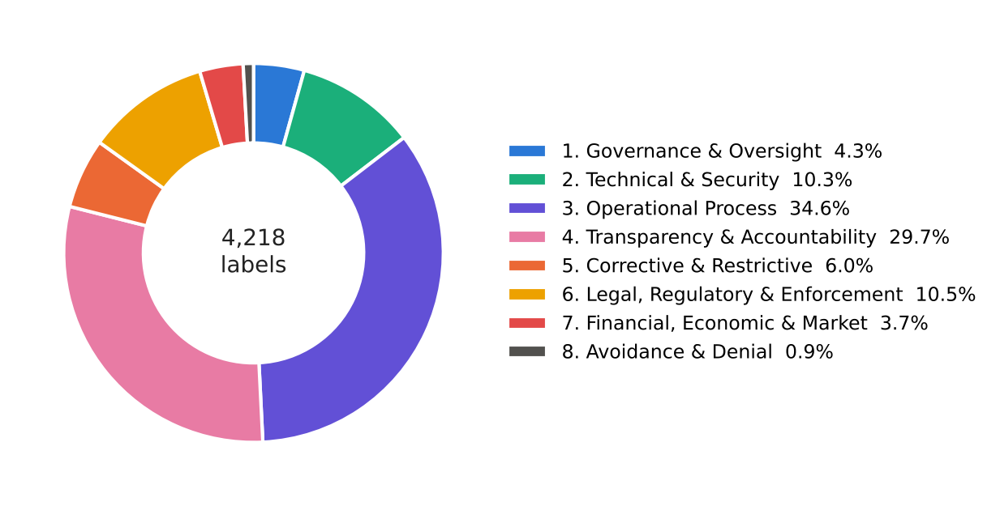

**Labels in existing vs added subcategories**
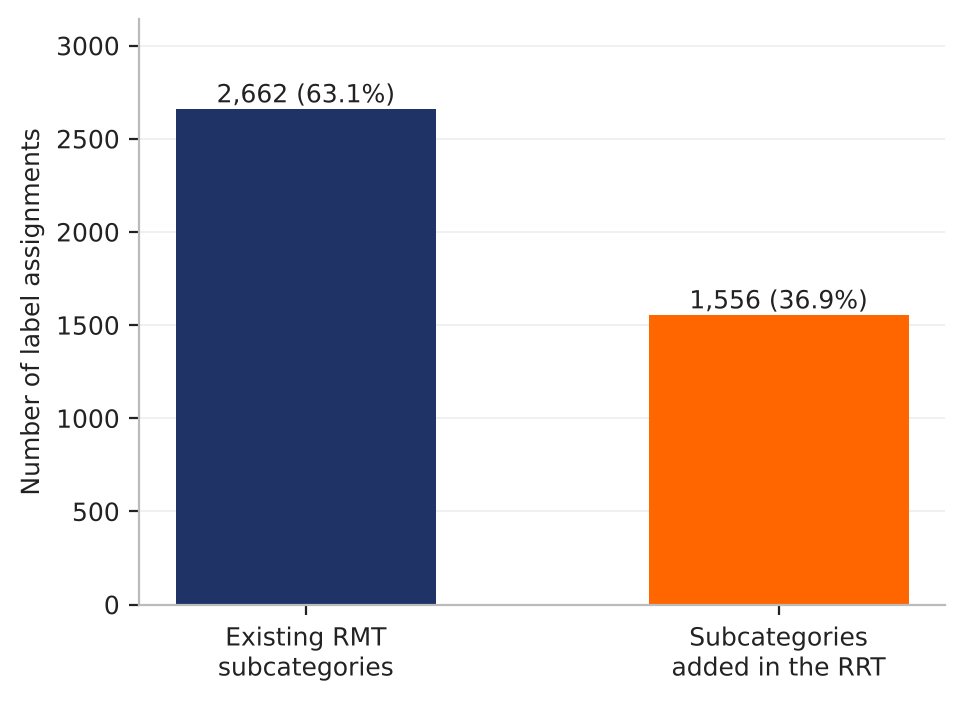

### AIAAIC

**Number of labels per subcategory**
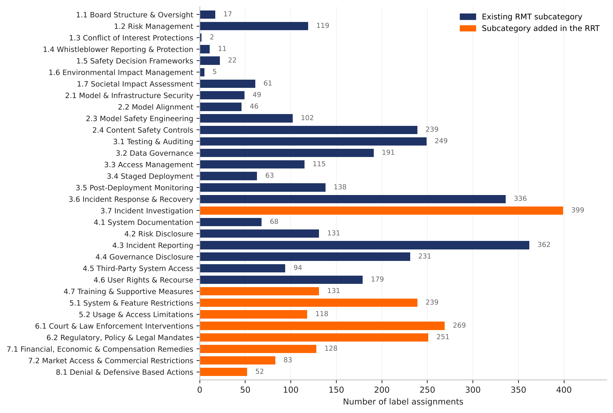

**Share of labels by category**
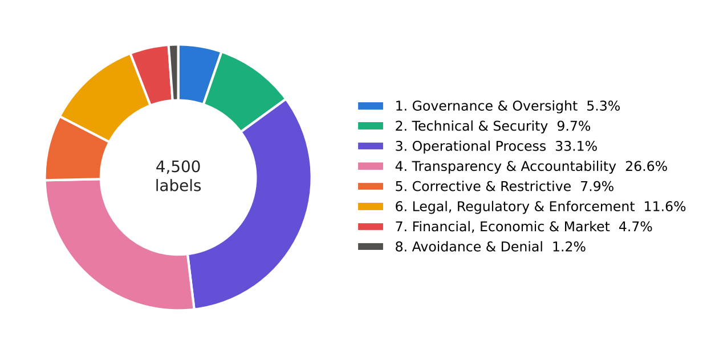

**Labels in existing vs added subcategories**
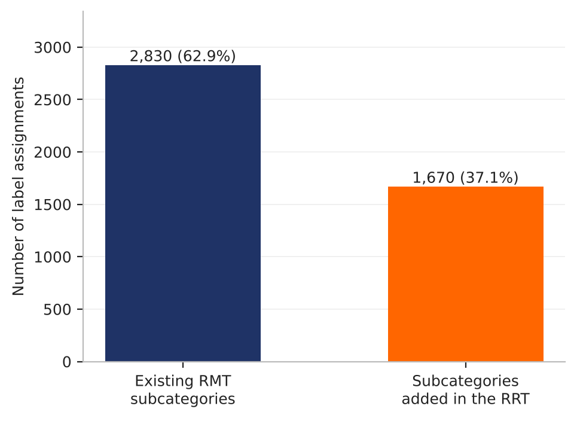

### OECD AIM

**Number of labels per subcategory**
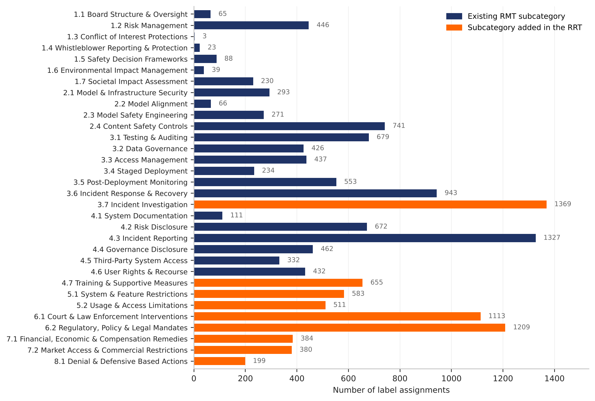

**Share of labels by category**
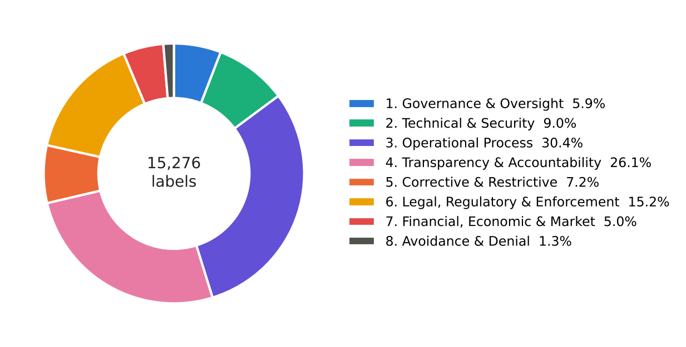

**Labels in existing vs added subcategories**
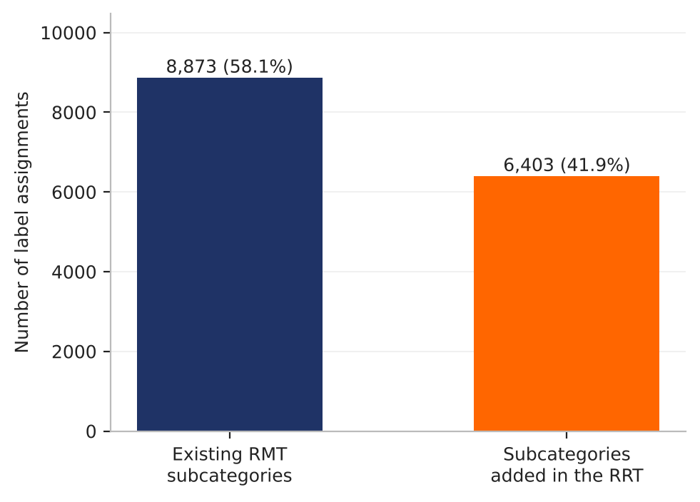

---

## Authors, License & Citation

**Authors:** [Evgenija Popchanovska](https://github.com/popchanovska), [Ana Gjorgjevikj](https://github.com/g-ana), [Maryan Rizinski](https://github.com/rizinski), Lou Chitkushev, Irena Vodenska, [Dimitar Trajanov](https://github.com/trajanov)

**License:** This project is licensed under the [Apache License 2.0](LICENSE.txt).

**Citation:**
```bibtex
@article{KEYWORD,
  title={When AI Fails, What's Next? A Data-Driven Taxonomy of Real-World AI Incident Responses},
  author={Popchanovska, Evgenija and Gjorgjevikj, Ana and Rizinski, Maryan and Chitkushev, Lubomir T and Vodenska, Irena and Trajanov, Dimitar},
  journal={XXX},
  volume={XXX},
  pages={PAGES},
  year={2026},
  publisher={XXX}
}
```
